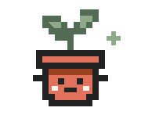

  

  

  Senior Software Engineer at LinkedIn · Bay Area ☀️

Cornell '22 · Grace Hopper Celebration speaker '24 🎤

I love building things that bring people together, boost productivity, and spark creativity ✨

<h3 align="center">☕ Let's talk about</h3>

  AI · emerging tech · UX/UI · accessibility · creativity · design thinking 
  women in tech · community building · travel ✈️ · what you're reading 📚

<h3 align="center">🧰 What I build with</h3>

  
  
  
  
   
  
  
  
  

<h3 align="center">🔗 Find me</h3>

Coffee, bakery crawl, or a quick video call? Let's swap tech stories 🥐

  <a href="https://riyajaggi.github.io/">My website</a>
  &nbsp; · &nbsp;
  <a href="https://www.linkedin.com/in/riyajaggi/">LinkedIn</a>
  &nbsp; · &nbsp;
  <a href="https://riyajaggi.github.io/art/">My art</a>

Nice to meet you! Let's collaborate and make something great 🫶

